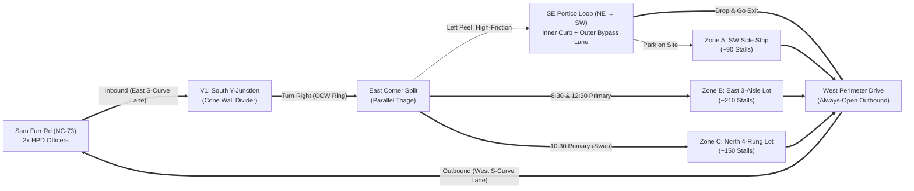

# Union Church CLT — Huntersville Campus 3-Service Traffic & Expansion Playbook
**Campus Location:** Ambassador Christian School (`11901 Sam Furr Rd / 2520 Ambassador Christian Way, Huntersville, NC 28078`)  
**Service Schedule:** **8:30 AM • 10:30 AM • 12:30 PM** (70–75 min services; 45–50 min turnaround windows)  
**Current Infrastructure:** 80,081 sq ft building (**2,100-seat auditorium**) on **~21.9–28 acres**, with **4.29 acres currently paved (~450 stalls)**  

---

## 1. How Drop-Off & Exit Work Without Trapping Anyone (The "Always-Open Escape" Rule)

You spotted the single biggest flaw in traditional church traffic plans: **if you convert the main entrance road (`Ambassador Christian Way`) into 100% Inbound-Only, nobody can get out**—not a parent dropping off a teen, not an Uber/Lyft, not an early departure, and not the 8:30 AM congregation when 10:30 AM arrivals start showing up at 9:50 AM.

### The Geometric Solution on Your Exact Property:
1. **Never Make the S-Curve 100% Inbound (Keep the West Lane Outbound at All Times):**
   * According to the *Highway Capacity Manual (HCM)*, a single unobstructed inbound lane moving continuously at 15 mph without stop signs or backing-out cars carries **1,500–1,800 vehicles/hour (25–30 cars/minute)**.
   * Therefore, **Ambassador Christian Way** only needs **1 continuous Inbound Lane (East side)** up to the South Y-Junction (`V1`), leaving the **West side of the S-curve ALWAYS OPEN as a dedicated Outbound Lane** from 7:45 AM to 1:30 PM (and flipping to **2 Outbound Lanes** only after the final 12:30 PM service at 1:45 PM when no one else is arriving).
2. **Run the Curved SE Portico Drop-Off Loop (`WAY 679026090`) from NE → SW (Passenger Door to the Curb):**
   * Because the 2,100-seat auditorium sits **North/Northwest** of the curved Portico Loop, running the Portico Loop **Northeast-to-Southwest (entering at the East Corner `347, 334` and exiting at the SW Corner `243, 403`)** puts the **Passenger (Right) Door flush against the lobby sidewalk**!
   * When a car finishes unloading at the SW end of the Portico Loop (`243, 403`), it has **two zero-conflict choices**:
     * **Option A (Driver Parking on Campus):** Turn **Right (NW)** up the West Drive directly into **Zone A (SW Side Lot)** or **Zone C (NW Curved Bays)** to park.
     * **Option B (Drop-and-Go / Rideshare / Leaving Campus):** Continue **Straight/Left** (`243, 403 → 274, 445`) directly into the **Always-Open West Outbound Lane of the S-Curve** to Sam Furr Rd!

---

## 2. Chick-fil-A & ITE Traffic Engineering Principles Applied to 8:30 / 10:30 / 12:30

### The 5 Industry Principles (Chick-fil-A Queuing + ITE Land Use 560):
1. **Isolate High-Variance Servers from Low-Variance Flow (Chick-fil-A "Mobile Thru" Separation):**
   * In queuing theory ($M/M/c$), mixing a car that needs 45 seconds to unload a stroller with 20 cars that just need to park causes cascading queue spillback.
   * By peeling Drop-Offs, ADA, and VIPs left into the **250-ft Curved SE Portico Loop** at the East Corner, 80% of general traffic flows straight into **Zone B / Zone C** at 15 mph with zero stops.
2. **Dual-Lane Unloading + Escape/Bypass Lane in the Portico Loop:**
   * Never unload 1 car at the front door while 10 cars wait behind it. Use the full width of the curved SE Portico drive:
     * **Right Curb Lane (Unloading Zone):** Pull 6–8 cars all the way up to the last cone and unload simultaneously.
     * **Left Outer Lane (Chick-fil-A Bypass Lane):** As soon as Car #5 finishes unloading, it merges left into the bypass lane and exits immediately without waiting on Car #1.
3. **"Ping-Pong" (A/B) Zone Alternation Across the 3 Services (`8:30 → 10:30 → 12:30`):**
   * The #1 cause of gridlock between back-to-back services (`9:45–10:25 AM` and `11:45 AM–12:25 PM`) is letting arriving 10:30 AM drivers turn down an aisle where 8:30 AM drivers are backing out of spaces.
   * **Solution:**
     * **8:30 AM Service** parks primarily in **Zone B (East 3-Aisle Lot, ~210 stalls)** + **Zone A (~90 stalls)**.
     * **At 9:45 AM (Service 1 Dismissal / Service 2 Early Arrival):** While 8:30 AM cars are backing out of **Zone B** and exiting counter-clockwise down the West Drive, **V3 cones off Zone B entry** and waves all early **10:30 AM arrivals (9:45–10:10 AM)** straight past Zone B into **Zone C (North 4-Rung Triangle Lot, ~150 stalls)**!
     * **At 10:10 AM:** Once Zone B has flushed its 8:30 AM cars, **V3 re-opens the freshly emptied Zone B** to absorb the final 10:10–10:30 AM surge!
     * **At 11:45 AM (Service 2 → Service 3 Swap):** Repeat in reverse for the **12:30 PM service**!
4. **Zero-Crossover Counter-Clockwise Ring Road (ITE Best Practice):**
   * Inbound vehicles stay on the **East** side of the S-curve and the **Southeast/East** side of the building.
   * Outbound vehicles drain down the **Northwest/West** side of the building and the **West** side of the S-curve.
   * A continuous line of cones through the **South Y-Junction (`V1`)** prevents any left-turn crossover between entering and exiting streams.
5. **Batch-Release Pedestrian Crosswalks (`V2`):**
   * Instead of letting pedestrians trickle across the Portico Loop continuously (which freezes vehicles), hold pedestrians behind stanchions for 45–60 seconds and cross them in platoons of 30+.

---

## 3. Total Lot & Parcel Analysis: Why 2,100 Seats Only Have 450 Stalls (and How to Add +400 Stalls)

### Why the Mismatch Exists:
* **Total Parcel Size:** **~21.9 to 28.0 Acres** (`~954,000–1,220,000 sq ft`)
* **Building Footprint (`WAY 334506005`):** **69,537 sq ft (1.60 Acres)** on the ground (**80,081 gross sq ft** across 2 levels, including the **2,100-seat auditorium**).
* **Existing Paved Parking (`WAY 1112600979` + `1112600980`):** **186,875 sq ft (4.29 Acres)** = **~450 lined stalls** (`~415 sq ft/stall` including circulation loops).
* **The Zoning/Capacity Gap:** Under standard municipal & ITE guidelines (**1 stall per 2.5–3.0 auditorium seats**), a 2,100-seat auditorium requires **700 to 840 parking spaces (~6.8–7.5 acres of parking)**. When the building was originally constructed, only **Phase 1 parking (4.29 acres / 450 stalls)** was paved, leaving **15+ acres of the parcel undeveloped**!

### Where to Create +400 New Parking Spaces on Campus (Outside the Ramah Creek Buffer):

| Expansion Zone | Exact Location on Parcel | Dimensions & Area | New Stalls Added | Strategic Benefit |
| :--- | :--- | :--- | :---: | :--- |
| **Zone E1: North-East Infill Wedge** *(Priority #1)* | The unpaved V-shaped notch directly between the East edge of the **North Triangle Lot (`339 ft`)** and the North edge of the **East Fan Lot (`355 ft`)** | `339 ft × 190 ft` **~60,000 sq ft** *(1.38 Acres)* | **+175 Stalls** | Already bordered on 2 sides by existing asphalt roads! Connects Zone B and Zone C into a **complete outer ring road** and is 100% upland (far north of Ramah Creek). |
| **Zone E2: Northwest Cleared Terrace Pad** *(Priority #2)* | The cleared upland meadow immediately West/Northwest of the **NW Curved Bays (`WAY 679026091–92`)** before the western tree line | `380 ft × 140 ft` **~50,000 sq ft** *(1.15 Acres)* | **+145 Stalls** | Already cleared turf/meadow outside the creek floodplain; feeds directly into the West Outbound Perimeter Drive for rapid dismissal. |
| **Zone E3: East & SW Outer Perimeter Bays** *(Priority #3)* | A 60-ft outer bay along the eastern curve of **Zone B (`WAY 679026097`)** + angled shoulder parking on the outer side of the **SW Drive** | `400 ft × 65 ft` **~28,000 sq ft** *(0.65 Acres)* | **+80 Stalls** | Fast-in, fast-out perimeter stalls requiring minimal grading. |
| **TOTAL EXPANSION** | **Upland Infill (E1 + E2 + E3)** | **~138,000 sq ft** *(3.18 Acres)* | **+400 Stalls** | **Increases campus from ~450 to ~850 stalls**—matching the full **2,100-seat auditorium** capacity! |

> [!TIP]
> **Phased Construction Recommendation:**  
> Before pouring permanent asphalt (which triggers full Town of Huntersville stormwater detention review), **Zone E1 (1.38 acres, +175 stalls)** and **Zone E2 (1.15 acres, +145 stalls)** can often be activated first as **stabilized turf / geocell gravel overflow** for Dream Team and dry-weather Sundays while civil engineering permits for permanent paving are processed.

---

## 4. Master 3-Service Sunday Timeline (8:30 AM • 10:30 AM • 12:30 PM)

| Time | Phase | Traffic & Lot Operation |
| :--- | :--- | :--- |
| **7:15 AM** | **Cone Setup** | Place cone line down the center of **Ambassador Christian Way (S-Curve)** and through **V1 (South Y-Junction)** separating the **East Inbound Lane** from the **West Outbound Lane**. |
| **7:30 AM** | **Dream Team Arrival** | All staff & Dream Team park in **Zone E1 / Zone D (Turf Overflow)** so 100% of the 450 paved spaces remain open for guests. |
| **8:00 – 8:35 AM** | **Service 1 Arrival (8:30 AM)** | Inbound traffic climbs the **East S-Curve Lane**, turns **Right at V1**, and loads sequentially into **Zone B (East 3-Aisle Lot)** & **Zone A**. Drop-offs peel left at the East Corner into the **NE→SW Portico Loop** and either park in Zone A or exit down the **West S-Curve Outbound Lane**. |
| **9:40 – 10:25 AM** | **Swap #1 (8:30 Out / 10:30 In)** | • **8:30 AM Egress:** Drains from **Zone B & Zone A** counter-clockwise around the North/West loop down the **West S-Curve Outbound Lane** to NC-73. • **10:30 AM Early Ingress (9:45–10:10 AM):** Climbs the **East S-Curve Lane**, bypasses Zone B, and loads sequentially into **Zone C (North 4-Rung Triangle Lot)**. • **10:10 AM Flip:** Once Zone B finishes emptying, reopen **Zone B** for the 10:10–10:30 AM peak arrivals. |
| **11:40 AM – 12:25 PM** | **Swap #2 (10:30 Out / 12:30 In)** | • **10:30 AM Egress:** Drains counter-clockwise down the **West Perimeter Drive** and **West S-Curve Outbound Lane**. • **12:30 PM Ingress:** Climbs the **East S-Curve Lane** and loads sequentially into whichever zone (**Zone B** or **Zone C**) was emptied first. |
| **1:40 – 2:05 PM** | **Final Egress (12:30 PM Dismissal)** | Because there is no 4th service arriving, **V1 flips the S-Curve cones to Dual Outbound Lanes**: West Drive exits via the Left Lane (Westbound NC-73); East Lot exits via the Right Lane (Eastbound NC-73 toward I-77) under HPD batch control. |
